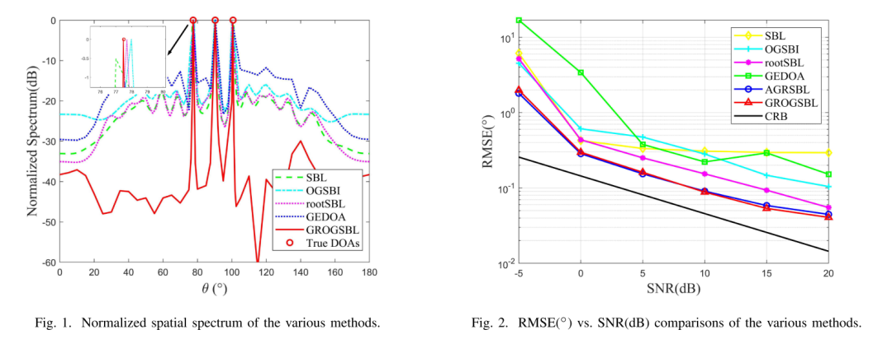
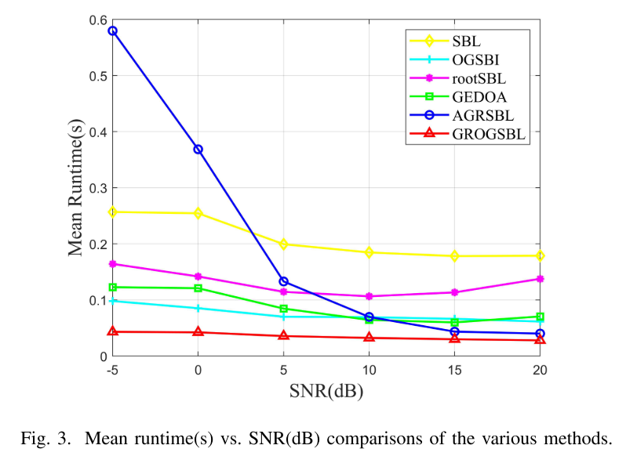
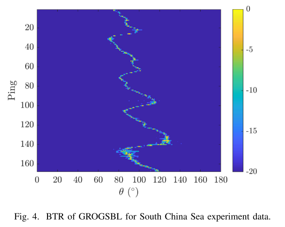
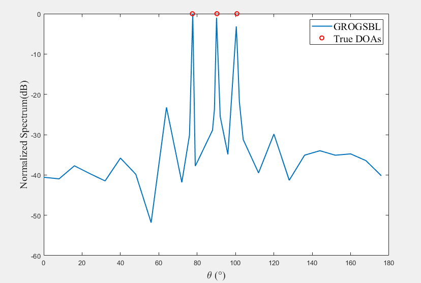

# DOA Estimation Based on Sparse Bayesian Learning: An Offline DOA Estimation Method [with MATLAB Code]

Introduction: Direction of Arrival (DOA) estimation is a critical issue in array signal processing, with wide applications in radar, sonar, speech, and wireless communication [1]. Multi-signal Classification (MUSIC) and Eigenvector Transform Based Inversion Techniques (ESPRIT) are currently popular narrowband DOA estimation methods.
Over the past decade, Sparse Signal Reconstruction (SSR) methods have gained significant popularity in the field of DOA estimation. Among these methods, Sparse Bayesian Learning (SBL) is one of the most widely used approaches. SBL utilizes sparse information by adopting a Bayesian perspective to hypothesize the prior knowledge of interest signals. Additionally, researchers have extended this method to address broadband DOA estimation problems using multiple dictionaries [7], [8].
However, the methods mentioned earlier are susceptible to grid misalignment issues. When the true DOA does not align with the grid, grid misalignment can lead to performance degradation. Several off-grid methods have been proposed to address this issue. Yang [9] was the first to introduce an off-grid model within the SBL framework, which represents the true DOA as a first-order Taylor expansion of initial grid points, effectively reducing off-grid errors. However, when the grid spacing is large, the Taylor expansion model may be less accurate. The development of RootSBL [10] aimed to enhance the accuracy of uniform linear array (ULA) DOA estimation. However, the complexity of the algorithm is linearly related to the number of array elements, leading to slower execution speeds as the array size increases. Based on these findings, the grid evolution DOA (GEDOA) estimation method [11] introduced a grid fission process that dynamically evolves the grid from coarse to dense. Although this represents an improvement, GEDOA shares the same issues with rootSBL and is only applicable to ULA. In recent research, Wang [12] proposed an adaptive grid refinement method and a post-processing DOA search process, which to some extent improved the accuracy and speed of DOA estimation. However, it was found that this method exhibited instability and significantly slowed down at low signal-to-noise ratio (SNR) during implementation.
To overcome these challenges, we adopted a Bayesian framework without Gamma priors, ensuring sparsity through the SBL principle [13]. This method utilizes a first-order Taylor expansion to represent the true DOA in the off-grid model. The grid refinement process aims to insert new grid points based on model priors during the learning process. To update hyperparameters, we employed the expectation-maximization (EM) algorithm [14]. Additionally, the use of off-grid extraction methods has improved DOA estimation performance.
The article includes illustrations.
Conclusion: To address this issue, a novel off-the-shelf DOA estimation algorithm based on sparse Bayesian learning is proposed. A stable grid encryption method based on the first-order Taylor expansion of an off-the-shelf model is also introduced. Furthermore, after convergence in iterations, an off-the-shelf DOA extraction algorithm is introduced to further improve the estimation accuracy. Simulation and experimental results verify the significant improvement in DOA estimation accuracy and running speed achieved by the proposed methods. However, one of the key requirements for our work is the prior knowledge of source numbering, and solving the problem of achieving higher accuracy and faster convergence under low signal-to-noise ratio remains a challenge that we will address in future work.

## Images

<!-- PAYMENT_BLOCK -->

## Get this dataset

- Payment link (Stripe): [Buy now](https://buy.stripe.com/3cs8yP7sY87d0vu9AB)
- Payment QR code: 

<!-- /PAYMENT_BLOCK -->
